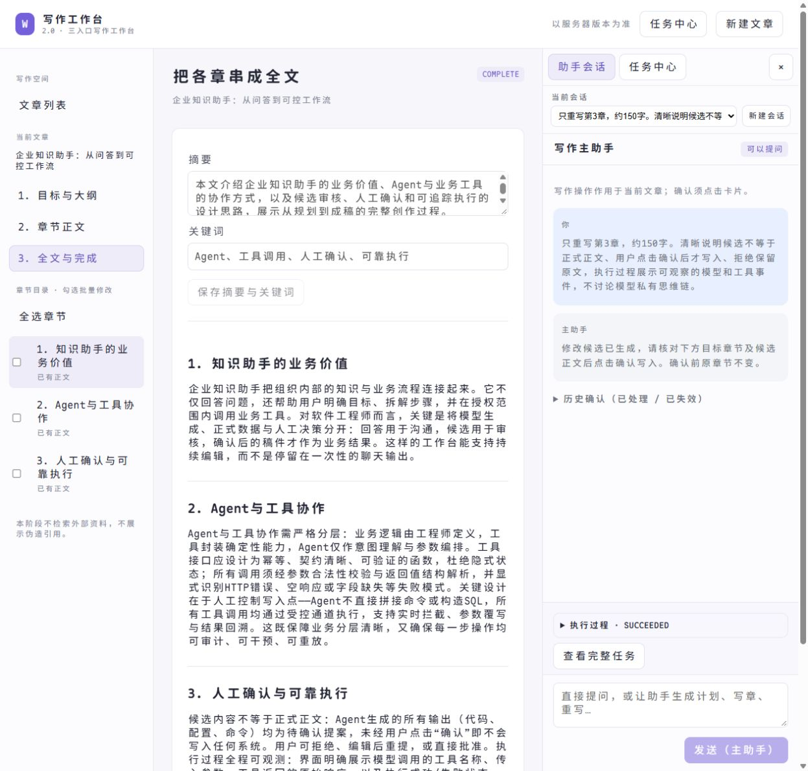
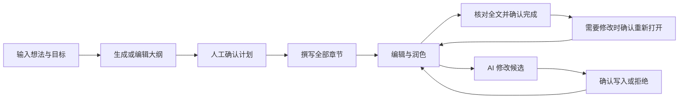
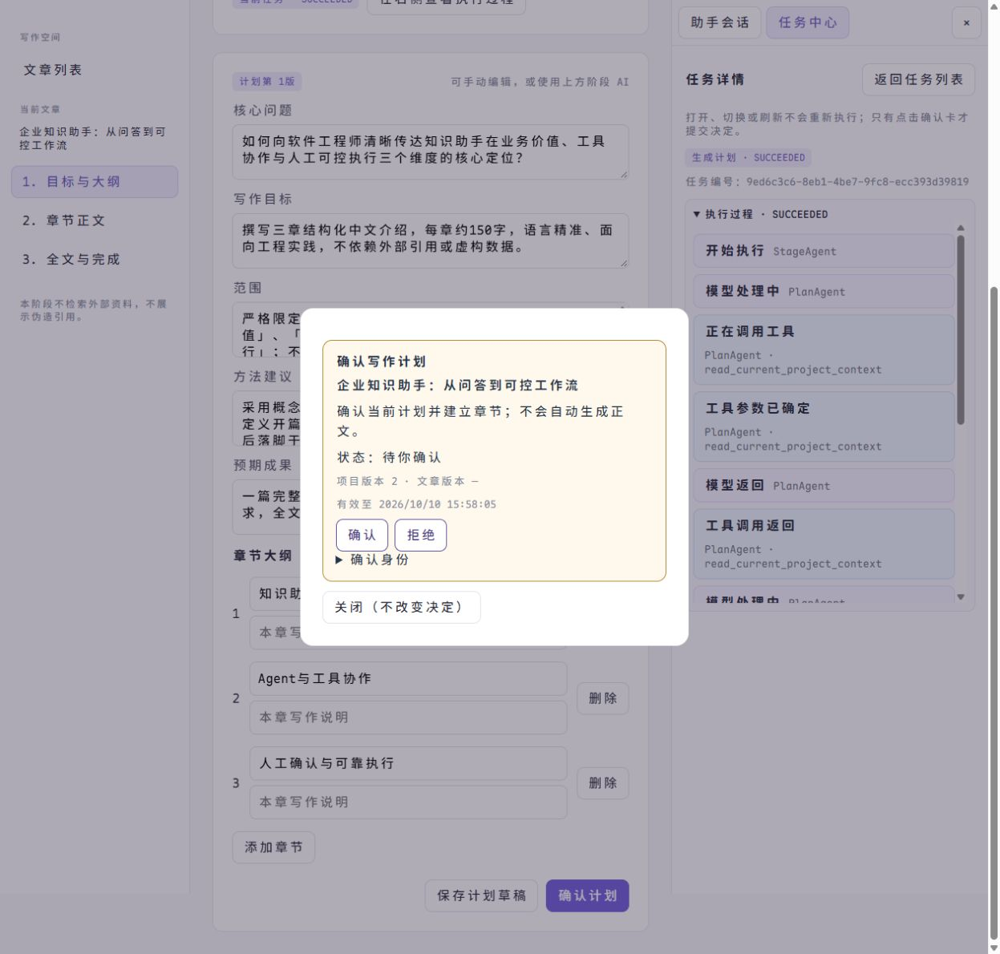
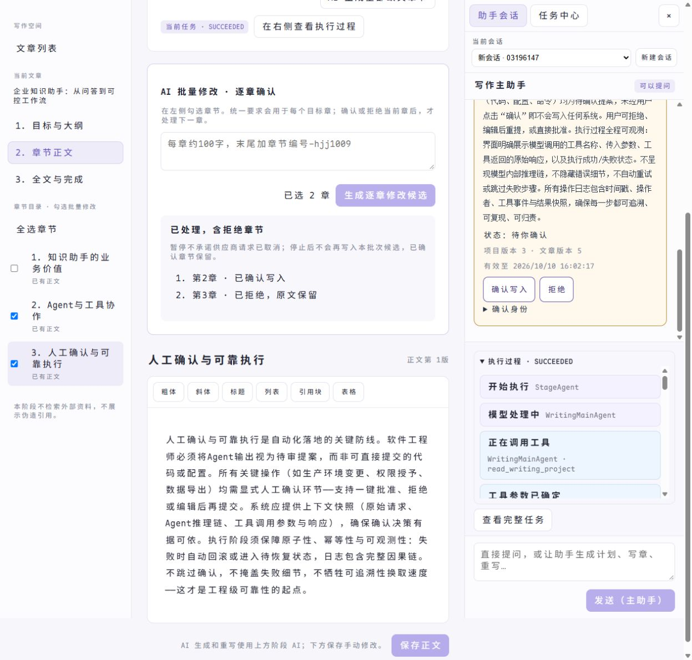
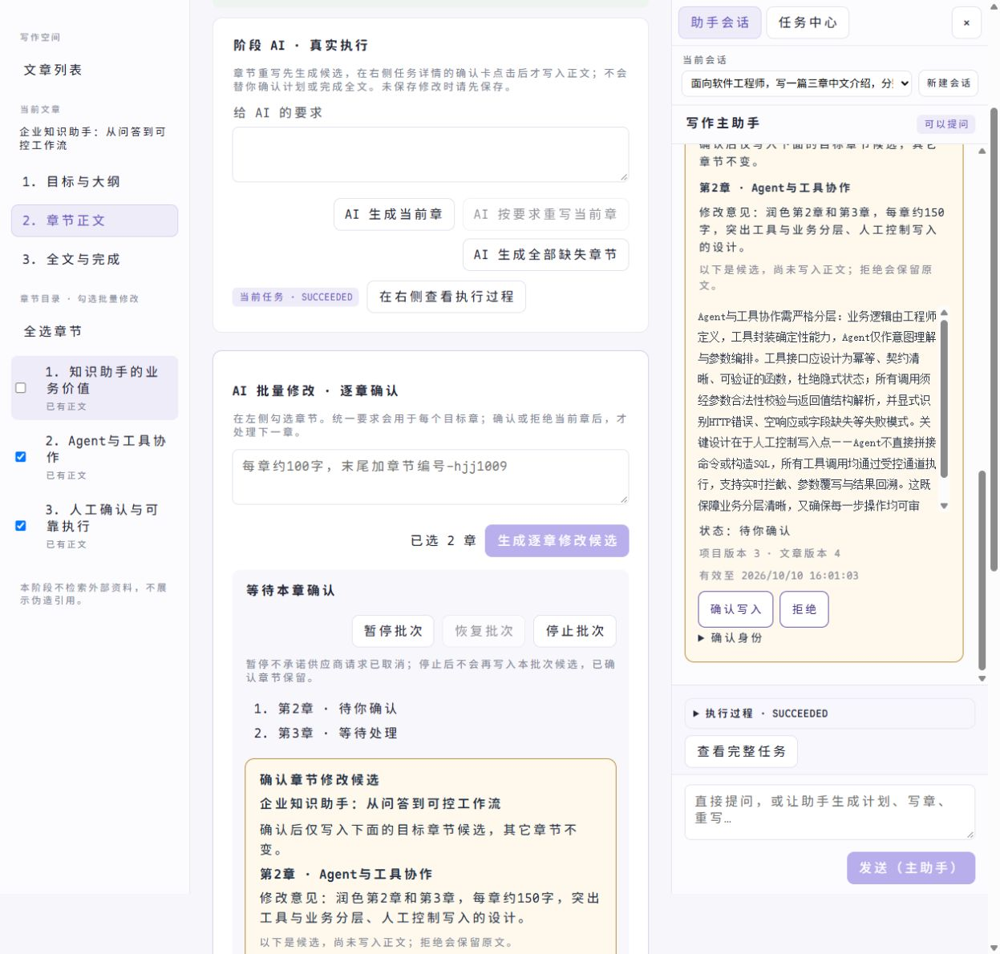
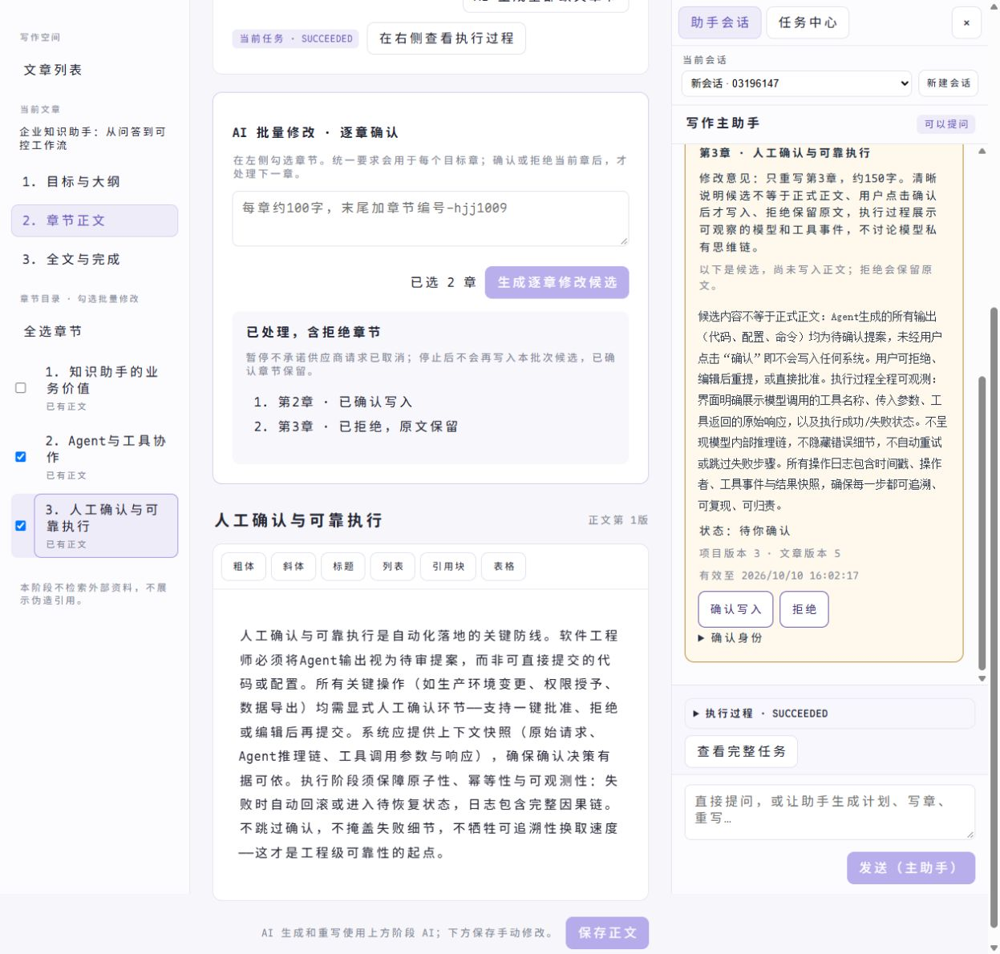
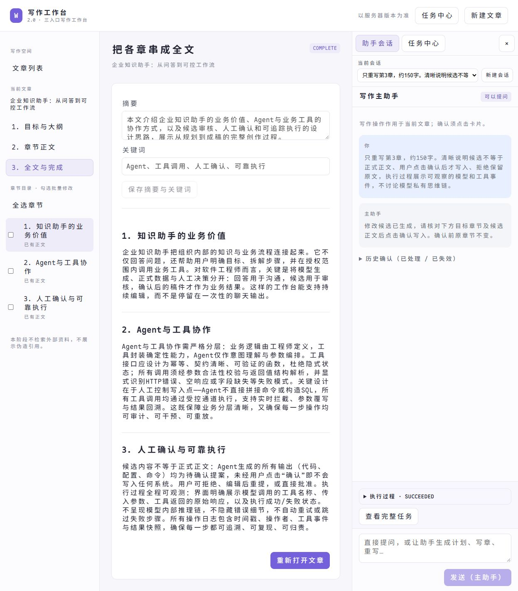
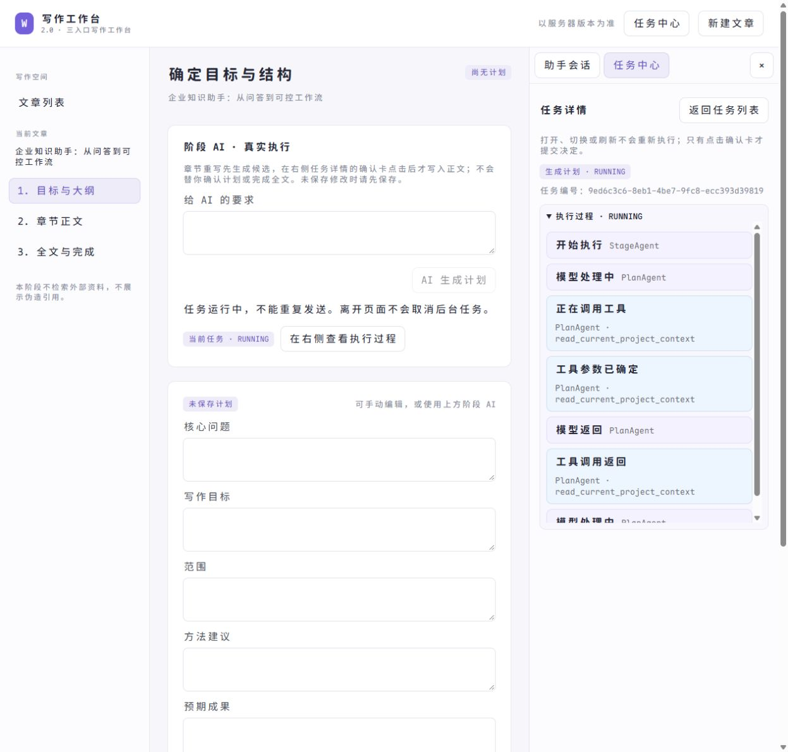
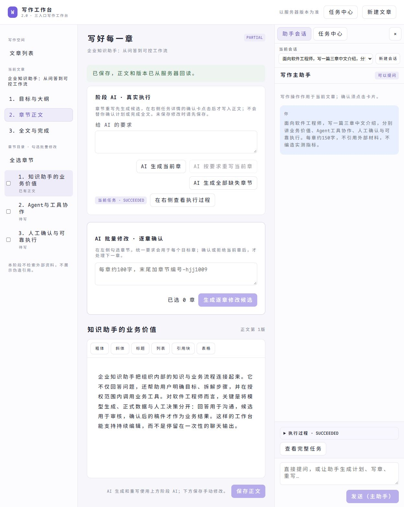
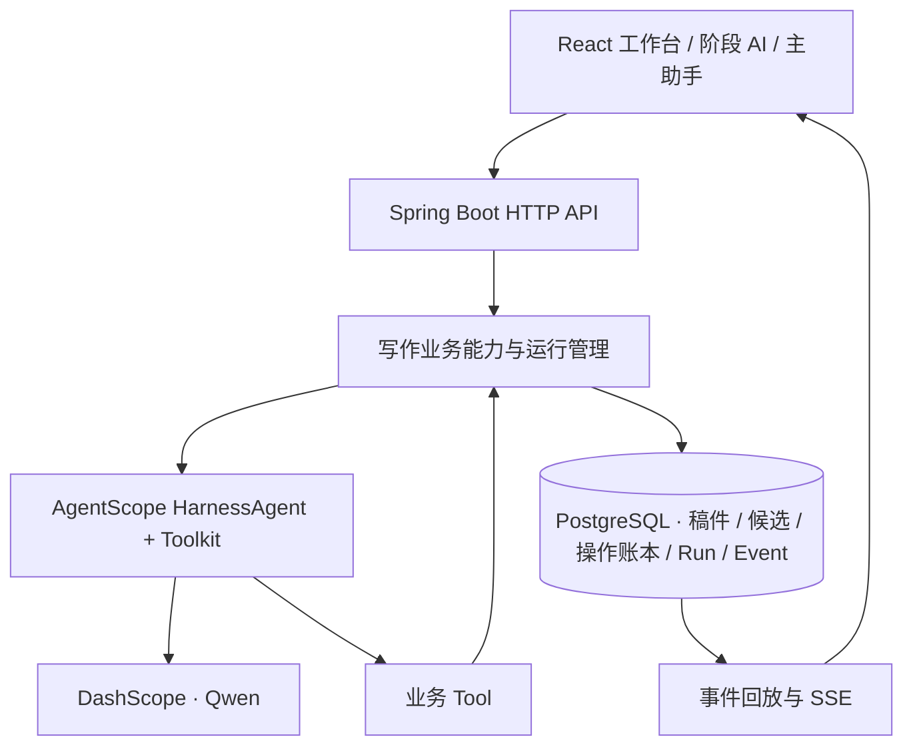

# Writing Agent 2.0

**让长文创作从“生成一段文字”，走向可编辑、可确认、可追踪的完整工作流程。**

Writing Agent 是基于 Java、AgentScope HarnessAgent 和 React 构建的写作工作台。它将大纲规划、章节写作、定点改写与全文完成串成同一个创作流程：你可以手动操作，也可以在当前阶段调用 AI，或通过主助手对话驱动写作。



> **一份稿件，三种入口；AI 负责生成候选，用户掌握写入决定。**

## 为什么做这个项目

长文写作需要反复调整结构和内容，单纯的聊天输出无法解决稿件版本、局部修改、批量执行与人工审核之间的衔接。

这个项目把 **Agent 推理、业务操作和用户确认** 分开：模型负责理解请求、选择工具和生成内容；业务层负责目标校验、版本控制与持久化；用户通过确认卡决定修改候选是否写入。聊天回复、执行记录和正式稿件各有自己的职责，不用模型的“已经完成”替代真实业务结果。

## 一篇文章，三种操作方式

| 操作方式 | 适合做什么 |
|---|---|
| 手动工作台 | 制定大纲、编辑章节、调整摘要与关键词、确认文章完成 |
| 阶段 AI | 在当前页面生成计划、补齐章节、润色目标章或发起逐章批量修改 |
| 写作主助手 | 自然语言提问、读取项目进度、生成大纲、撰写章节、定点与批量改写 |

三种入口使用同一套业务能力与稿件数据。AI 修改既有正文时，先生成候选，再由用户确认；批量改写按目标章节逐个生成、逐个审核，拒绝某章会保留该章原文。

## 核心创作流程



- **从想法到全文**：项目、大纲、章节正文、摘要和关键词统一管理。
- **精确修改**：按目标章读取真实内容与版本，其它章节不随局部修改而覆盖。
- **逐章人工审核**：候选内容与正式正文分离，确认卡展示目标、修改意见、候选及固定回执。
- **持续创作**：稿件和会话保存至 PostgreSQL，刷新后回读服务器状态。
- **多会话助手**：独立聊天记录、会话切换与本机草稿恢复。
- **实时执行面板**：模型、工具、产物与人工确认事件通过 SSE 展示；助手和任务中心共用右侧面板。

## 看一遍完整创作过程

下面用同一篇三章演示文章，展示从大纲到全文的真实页面操作。截图中的模型调用使用 DashScope，正文与确认结果来自后端保存的数据。

| 你可以看到 | 对应能力 |
|---|---|
| 手动写首章，助手补齐指定章节 | 三种入口共用业务能力与同一份稿件，而非互相独立的聊天结果 |
| 运行过程区分模型、Tool、产物与结束事件 | 任务身份与执行过程可观察，不用转圈动画代替执行状态 |
| 批量润色逐章出卡，可以确认或拒绝 | 候选与正式稿件分离，明确目标，保留用户写入控制权 |
| 全文完成后刷新仍可回读 | 正式结果、版本、会话与操作回执持久化 |

### 1. 规划大纲，确认后再进入写作

阶段 AI 生成大纲，用户仍可编辑目标和章节。确认计划采用明确的人工确认弹窗，不让聊天里的“好的”代替业务确认。



### 2. 主助手通过工具驱动写作

助手读取当前稿件，选择业务工具执行；章节 Agent 使用真实计划和上下文生成内容。右侧实时展示模型调用、Tool 调用及产物事件，任务中心也能查看同一运行记录。



### 3. 批量修改，逐章审核再写入

勾选章节并填写统一要求，系统按目录顺序生成候选。确认当前章才写入新版本；拒绝保留原文；处理完当前章后再推进下一章。



### 4. 在聊天中核对候选，而不把聊天输出当正文

主助手也能发起定点改写。聊天中的确认卡展示目标章节、修改要求和候选内容；点击确认后可读取固定操作回执。



### 5. 汇总全文，确认完成

全部章节齐备后，用户在全文页面核对标题、摘要、关键词和正文，再确认文章完成。刷新后仍读取同一份正式稿件。



<details>
<summary>展开查看：阶段 AI 的实时执行与手动编辑</summary>

**阶段 AI 正在运行**：模型、工具和产物以不同事件卡展示；运行期间不可重复提交同一操作。



**手动编辑同一份稿件**：用户可以直接编辑正文并保存，AI 入口不是完成创作的唯一方式。



</details>

## 核心工程设计

### Agent 与业务能力分层

主助手通过 AgentScope Toolkit 注册业务工具，按用户请求选择操作；计划和章节 Agent 负责具体生成。HTTP 页面操作与 Agent Tool 调用共用业务用例，数据库访问放在 JDBC Adapter 中，模型不直接写数据库。

### 可追踪的异步执行

请求受理与任务执行分离。Run 保存运行身份与生命周期，事件日志记录执行进展，SSE 负责通知页面。打开历史任务只读取记录，不重新触发模型；页面重连后以持久化状态核验结果。

### 可控的 AI 写入

计划确认、文章完成、重新打开及章节候选写入由服务端确认合同控制。版本校验防止旧候选覆盖新稿；操作键支持幂等重放和固定回执；结果未知时保留原操作身份，通过对账核验，不把超时直接当成失败后重复生成。



## 技术栈

| 层次 | 技术 |
|---|---|
| 后端 | Java 17、Spring Boot 4.0.4 |
| Agent | AgentScope Java / Harness 2.0.1、Toolkit、Middleware |
| 模型 | DashScope，默认 `qwen-plus` |
| 数据 | PostgreSQL 16、Flyway、JDBC |
| 前端 | React 19、TypeScript、Vite、Tiptap |
| 实时交互 | SSE、持久化事件回放 |

## 安装与启动

### 环境准备

- JDK 17、Maven 3.6.3 或更新版本。
- Node.js 22.12 或更新版本、npm。
- Docker Compose，用于启动独立 PostgreSQL。
- DashScope API Key，用于真实 AI 调用；手动写作不需要模型 Key。

下载仓库后进入项目根目录。以下步骤不依赖预先创建的工作区或文章。

### 1. 启动数据库

复制 `.env.example` 为 `.env`，将其中的数据库密码示例替换为你自己的本地密码。

```bash
docker compose up -d postgres
docker compose ps
```

默认数据库为 `writing_agent`，用户名为 `writing_app`，宿主机端口为 **5433**。容器进入 healthy 后再启动后端；业务表由 Flyway 自动创建。

### 2. 构建前端

```bash
cd frontend
npm ci
npm run build:server
cd ..
```

前端构建产物会复制到 Java 的静态资源目录，最终由同一个后端服务提供，不需要额外部署前端服务器。

### 3. 配置后端环境变量

Java 不会自动读取根目录 `.env`。请在启动终端或 IDEA Run Configuration 中设置：

| 环境变量 | 设置方式 |
|---|---|
| `WRITING_V2_DB_PASSWORD` | 与 `.env` 中的数据库密码一致，必填 |
| `DASHSCOPE_API_KEY` | 你的模型 API Key；也支持 `AI_DASHSCOPE_API_KEY` |
| `WRITING_V2_PORT` | 可选，默认 `8088` |
| `WRITING_V2_DB_URL` | 可选，使用已有数据库时指定完整 JDBC URL |
| `WRITING_V2_DB_USER` | 可选，默认 `writing_app` |

PowerShell 示例：

```powershell
$env:WRITING_V2_DB_PASSWORD = '<与你的 .env 一致的密码>'
$env:DASHSCOPE_API_KEY = '<你的 DashScope Key>'
```

macOS / Linux 示例：

```bash
export WRITING_V2_DB_PASSWORD='<与你的 .env 一致的密码>'
export DASHSCOPE_API_KEY='<你的 DashScope Key>'
```

请勿提交实际 `.env`、密钥、密码或带凭据的截图。

### 4. 启动 Java 服务

```bash
mvn package
java -jar target/writing-agent-2.0-0.2.0.jar
```

也可以在 IDEA 导入 `pom.xml`，选择 JDK 17，运行 `WritingAgent2Application`；需先完成前端构建。

打开 **[http://127.0.0.1:8088/](http://127.0.0.1:8088/)**。根地址自动进入新版 `/workbench/`，仓库不包含旧版页面。

### 5. 开始第一篇文章

1. 点击“新建文章”，填写主题与写作目标。
2. 在“目标与大纲”手动编辑，或用阶段 AI / 主助手生成计划。
3. 核对大纲后点击确认，再进入“章节正文”撰写全部章节。
4. 对需要润色的章节发起改写，核对候选并确认写入或拒绝。
5. 在“全文与完成”查看整篇文章并确认完成。

普通问题可直接在助手中新建会话提问，不要求先创建文章。执行期间可打开任务中心查看实时过程。

### 前端开发模式

后端启动后，在 `frontend` 目录执行：

```bash
npm run dev
```

打开 `http://127.0.0.1:5188/workbench/`；Vite 将 `/api` 代理到后端8088。后端端口不同时，在运行 Vite 前设置 `WRITING_API_URL`。

## License

[MIT](LICENSE)。依赖组件保留其各自的许可证。
